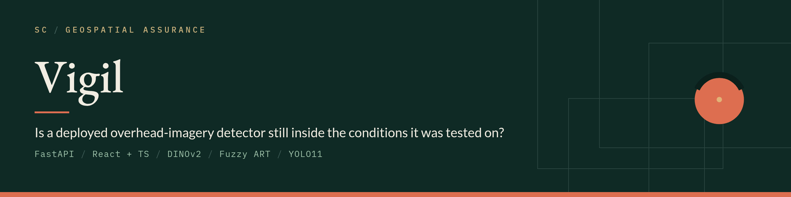
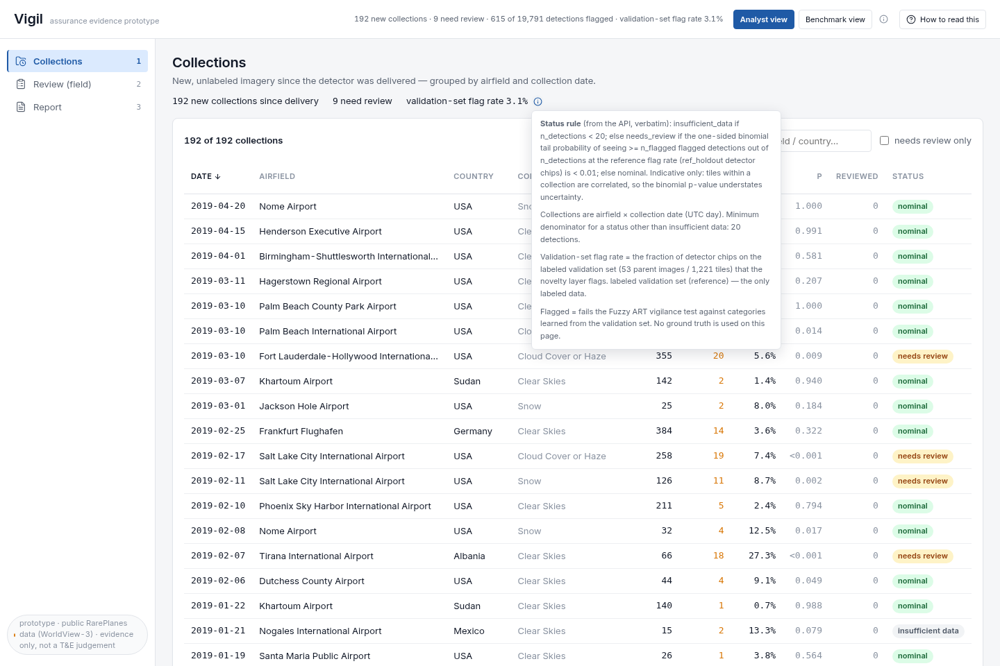
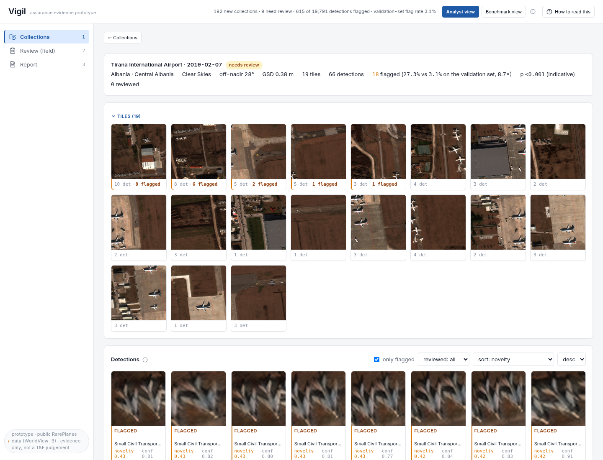
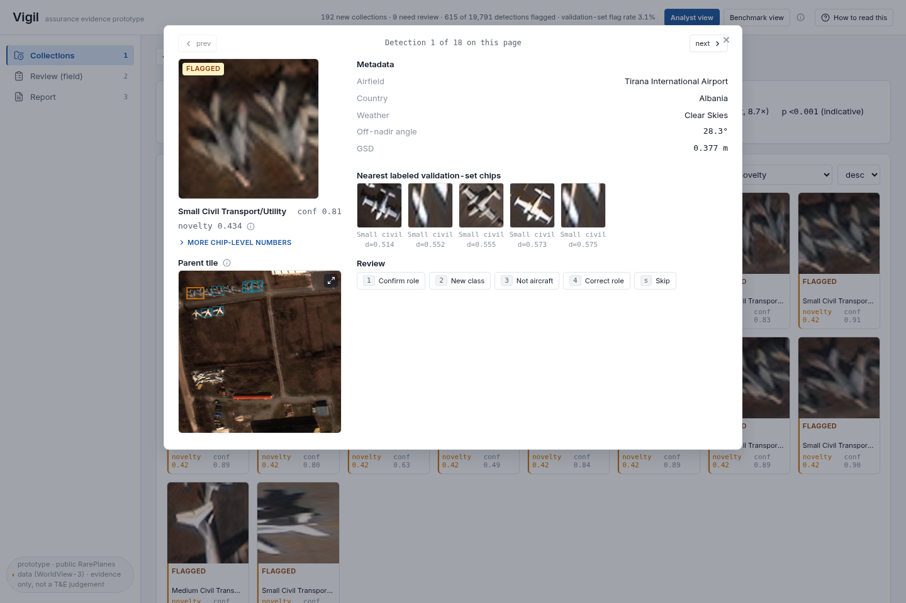

Vigil checks three signals on public RarePlanes (WorldView-3) imagery, all computed live from the data.

| Signal | Method |
|---|---|
| Scene drift | DINOv2 tile embeddings, 5-NN distance to reference, parent-image block bootstrap |
| Object novelty | Fuzzy ART vigilance test on chip embeddings, calibrated by cross-fitting |
| Detector recall | YOLO11n trained on the reference domain only, scored per condition |

Analysts review flagged detections, and new classes they label are applied as an overlay that never modifies the trained model. A version compare re-checks a control batch for regressions.



<table><tr>
<td></td>
<td></td>
</tr></table>

## Run

```bash
python -m venv .venv && .venv/bin/pip install -r requirements.txt
bash scripts/download_rareplanes.sh          # ~2.9 GB, anonymous S3
.venv/bin/python scripts/build_yolo_dataset.py
.venv/bin/python scripts/train_detector.py   # ~4 min on an RTX 2070
.venv/bin/python scripts/run_detector.py
bash scripts/run_pipeline.sh
bash backend/run_dev.sh                      # API on :8000
cd frontend && npm install && npm run dev    # UI on :5173
```

No GPU or download? `npm run mock` in `frontend/` serves synthetic data on :8000 in place of the backend.

## Limits

Prototype assurance evidence, not an accreditation. One sensor, 253 parent images. Splits are at parent-image granularity and military aircraft never enter the reference set, but the control batch informed model selection, so treat those numbers as selection results. Drift p-values are descriptive.

Data: RarePlanes (CosmiQ Works / In-Q-Tel), CC BY-SA 4.0.
